---
navigation:
  title: 仙纹图书馆 · 藏纹阵枢
  parent: index.md
  position: 56
  icon: minecraft:amethyst_shard
---

# 仙纹图书馆 · 藏纹阵枢

藏纹阵枢是仙纹图书馆用来调配装备附魔的装置。这座立式阵器占地 **11 × 11 格**，高 **13 格**，可以放在洞府内。这里收录的是设计蓝图。目前可以查看各部件的摆放位置，游戏内的方块制作和成阵功能尚未开放。

## 从正面定位

每张摆放图左边是本层的俯视坐标，下边是阵器正面。横坐标从左到右为 −5 至 5，纵坐标从后到前为 −5 至 5。右边从固定角度显示本层所在的位置，亮色方块是本层要放的部件，灰色方块是已经摆好的下层。第一层贴地。**藏纹匣位于第 2 层前沿中央**，横坐标为 0，纵坐标为 5，匣口朝向站在阵器正面的玩家。

1. 铺第 1 至 3 层石座，在正面留下藏纹匣的位置。从第 2 层起，按图向上搭左右承轴。
2. 按图从第 3 层起逐步合拢竖阵环，从第 4 层起立中轴。第 6 层开始摆斜阵环，玉芯在第 7 至 9 层围绕中轴展开。
3. 在第 8 层接通横阵环和共用轴节点，再继续向上合拢斜阵环和竖阵环。第 12、13 层安装上轴冠。

## 图中部件

蓝图共标出 **345 个摆放位置**。表中数量按部件位置统计，空格留空。

| 图中数字 | 部件 | 格数 |
| --- | --- | ---: |
| 1 | 玄青石座 | 213 |
| 2 | 承轴 | 20 |
| 3 | 竖阵环 | 31 |
| 4 | 横阵环 | 28 |
| 5 | 斜阵环 | 26 |
| 6 | 玉芯与中轴 | 20 |
| 7 | 上轴冠 | 2 |
| 8 | 共用轴节点 | 4 |
| 9 | 藏纹匣 | 1 |

## 从底到顶逐层摆放

### 底座与藏纹匣

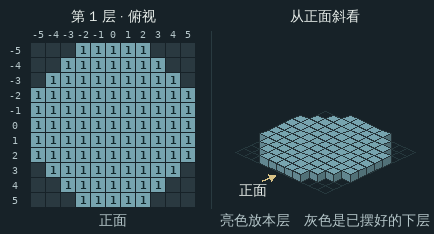

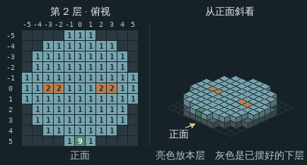

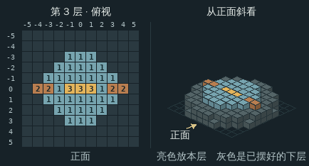

### 三道阵环与玉芯

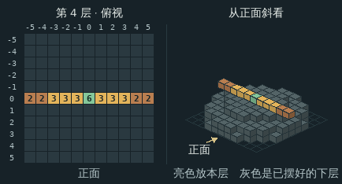

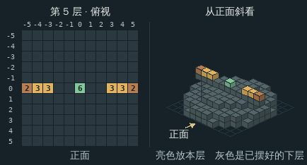

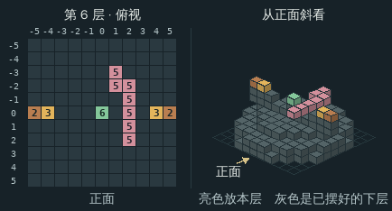

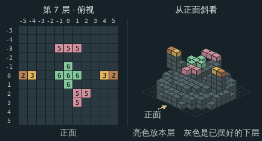

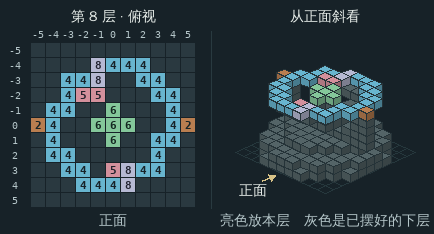

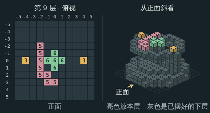

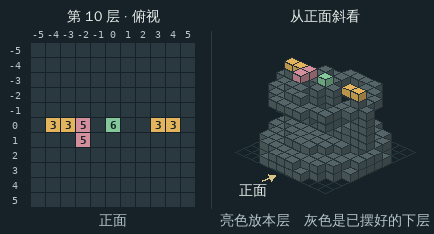

### 阵顶与轴冠

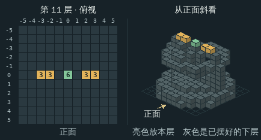

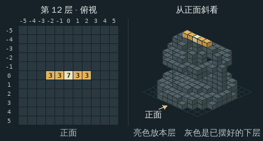

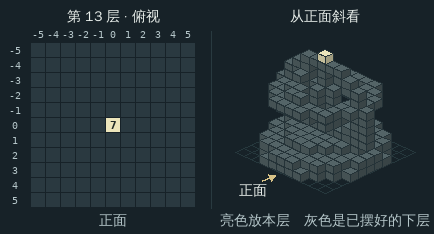

按设计，藏纹匣可以单独存取附魔。三道阵环接通后，阵器才开放装备调换。玩家从正面放入装备和配装玉简，确认前可以查看将收回和取用的附魔点数，以及本次所需的朱砂灵墨。

[返回锻造、组装与辅助火](./forging.md)
