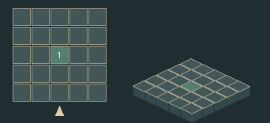
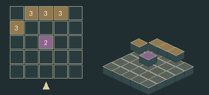
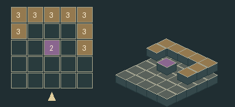
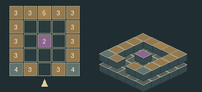
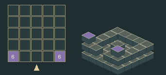
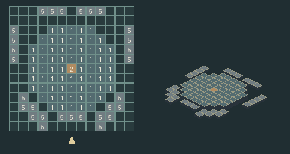
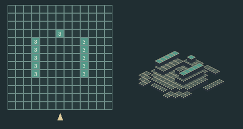

---
navigation:
  title: 扩展附魔台与篆纹阵
  parent: index.md
  position: 56
  icon: yuanxian:seal_table
item_ids:
  - yuanxian:enchanting_socket
  - yuanxian:crystal_shelf
  - yuanxian:focus_shelf
  - yuanxian:seal_table
  - yuanxian:seal_tile
  - yuanxian:seal_rack
  - yuanxian:seal_pivot
  - yuanxian:array_stone
  - yuanxian:array_stone_refined
  - yuanxian:array_stone_supreme
---

# 扩展附魔台与篆纹阵

## 用原版附魔台起步

在附魔台正下方放一格阵石托座，潜行右键附魔台即可开启扩展界面。围绕附魔台搭一圈 5 × 5 的书架，内圈八格留空，正面留一格进出。每列最多生效一座书架，可以与附魔台同高或抬高一格。同一高度内，台子和书架之间留出空隙。

下图左边是俯视摆法，右边是该层的立体位置。箭头在正面入口。图中的 **1** 是阵石托座，**2** 是原版附魔台，**3** 是普通书架。灰色部件已在下方摆好。

**地板层**把托座放在中央，台面在它正上方。

**空托座**搭四座普通书架，强度可达 4。

**入门阵石**装好后，再按图补四座普通书架，强度可达 8。

### 想多抽几条候选时

普通书架每座增加一点强度。紫晶书架增加一条候选，最多四条。定向书架让你选一条适用的附魔，提高它在抽选时的权重。两种书架都占外圈位置。同一列台面层和上一层都有书架时，只计先找到的有效书架。

下例在正面两角先放普通垫块（**4**），后排中央放定向书架（**5**）。最后把两座紫晶书架（**6**）放到垫块上。

## 炼制阵石

普通炼器鼎的「炼制阵石」可用紫水晶和修为炼出阵石。拿着阵石潜行右键原版附魔台，或者直接右键托座，可以装入阵石。空手右键外露的托座可以取回阵石。

| 阵石 | 强度上限 | 炼制条件 |
| --- | ---: | --- |
| 空托座 | 4 | 无需炼制 |
| 入门阵石 | 8 | 炼气三层、120 修为、1 块紫水晶碎片 |
| 凝纹阵石 | 12 | 炼气六层、360 修为、4 块紫水晶碎片 |
| 合印阵石 | 15 | 炼气九层、720 修为、8 块紫水晶碎片 |

实际附魔强度取普通书架贡献和阵石上限的较低值。以效率为例，I 至 V 级分别需要 0、4、8、12、15 点强度。

## 抽选、刻写和洗去附魔

把装备或普通书放进「器物」槽，朱砂灵墨放进「灵墨」槽。用青金石抽选时先把青金石放进对应槽，每次消耗一颗；也可直接用三点原版经验抽选。

点击候选条目选中它，用旁边的加减按钮调整等级。「刻写」按钮显示本次墨量。候选随器物保存，可以取走，再放回台上继续。已有附魔可从下方选择后升一级，只付增加的墨量；用两份灵墨「洗去」会移除该条附魔。想把效果存下来，可以到[仙纹图书馆](./cangwen_array.md)调配。

装备沿用附魔原本的适用条件。精铁镐、斧、铲、锄按各自工具类别获得适用附魔。炼器品质、柄材、耐久损伤和炼灵专长随原器物保留。

## 搭建和启用篆纹阵

中央是切角的 9×9 地基，连外围低台占地 13×13。下图以阵台面朝入口为准。阵石托座放在最底层中央，篆纹阵台放在托座正上方。外围和正面踏步都用下半格深板岩砖台阶。

| 图中数字 | 部件 | 数量 |
| --- | --- | ---: |
| 1 | 篆纹阵砖 | 91 |
| 2 | 阵石托座 | 1 |
| 3 | 篆纹承枢 | 11 |
| 4 | 篆纹阵台 | 1 |
| 5 | 深板岩砖台阶 | 29 |

空手右键阵台检查摆法。搭齐后，方块会收拢成青铜印函，六段低台上方出现牒片投影。再次右键阵台可打开附魔界面。拆掉任一结构件会让印函解体，剩余部件还原成搭建时的方块。装在阵台中的牒片会保留，拆掉阵台时掉出。

## 装入牒片

瞄准外围半透明投影，手持牒片右键装入或更换。空手右键查看槽内牒片和效果，潜行空手右键可取回。器身的小槽会同步显示装入状态。

两侧共十二个槽，接受铜背、紫晶和搭配篆牒。背面有两组，每组一格定向、一格刻法。第一组用于首抽，第二组用于续抽。

| 牒片 | 作用 |
| --- | --- |
| 铜背篆牒 | 每片增加 5 点阵力。 |
| 紫晶篆牒 | 每片使首抽多出现一条候选，首抽最多六条。 |
| 搭配篆牒 | 提高首抽中后续词条与已有候选相容的权重。 |
| 矿产定向篆牒 | 提高时运、精准采集的抽取权重。 |
| 养器定向篆牒 | 提高经验修补、耐久和效率的抽取权重。 |
| 兵刃定向篆牒 | 提高锋利、力量等伤害类附魔的抽取权重。 |
| 普通刻法篆牒 | 这组使用普通词条池。 |
| 保底刻法篆牒 | 续抽时尽量额外保留一条备选。 |
| 成组刻法篆牒 | 优先抽出一对相容候选。 |
| 宝藏刻法篆牒 | 开启宝藏时提高宝藏词条的抽取权重。 |
| 险刻篆牒 | 开启宝藏时进一步提高宝藏权重和负面词条概率。 |

## 在篆纹阵抽选和刻写

阵石决定基础阵力，铜背篆牒在其上累加，最高 50。没有阵石时从 4 点起算。阵力提高可开放部分更高等级，例如效率 VI、VII 分别在 25、45 点开放，时运 IV 在 40 点开放。词条仍需适配器物，同次刻写的词条必须相容。

每次抽选按当前阵力扣下品灵石，物品栏和随身灵石袋可合并支付。欠费时保留本轮候选。

| 阵力 | 每次抽选消耗 |
| --- | ---: |
| 0–15 | 3 个下品灵石 |
| 16–30 | 30 个下品灵石 |
| 31–50 | 1 个下品灵石 |

阵力达到 12 时，可以锁定一条候选及其当前等级，连续续抽都可保留，也可以在下一次抽取前改锁。阵力达到 15 时，可以同时刻写两条相容词条。刻写仍消耗朱砂灵墨。

「宝藏」开关把器物适用的宝藏附魔加入候选。对于有可附加诅咒的器物，常规抽取有 5% 的概率附带一个负面词条。开启宝藏后为 20%，在对应的险刻组里为 35%。附带词条会在刻写前显示，并随这一轮的候选一同刻上。更换牒片、阵力或宝藏设置后，请按新设置抽取。

## 工作台配方

### 附魔台托座和书架

<Recipe id="yuanxian:enchanting_socket" />

<Recipe id="yuanxian:crystal_shelf" />

<Recipe id="yuanxian:focus_shelf" />

### 篆纹阵部件

<Recipe id="yuanxian:seal_table" />

<Recipe id="yuanxian:seal_tile" />

<Recipe id="yuanxian:seal_pivot" />

<Recipe id="yuanxian:seal_disc_copper" />

<Recipe id="yuanxian:seal_disc_crystal" />

<Recipe id="yuanxian:seal_disc_pairing" />

其余定向和刻法牒片也可通过工作台合成。抽选后的刻写用[朱砂灵墨](./talismans.md)。阵石通过普通炼器鼎炼制，取出后可以换到另一座托座上。

[查看仙纹图书馆与藏纹阵枢](./cangwen_array.md)
