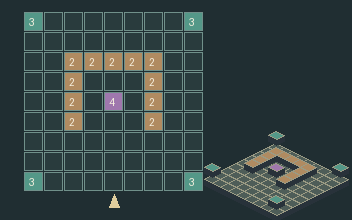
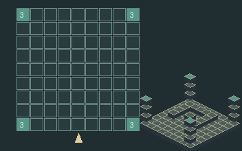
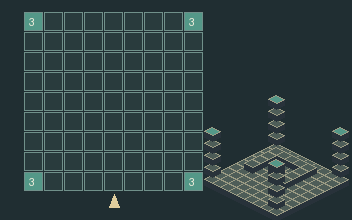

---
navigation:
  title: 扩展附魔台与篆纹阵
  parent: index.md
  position: 55
  icon: yuanxian:seal_table
---

# 扩展附魔台与篆纹阵

## 用原版附魔台起步

在附魔台正下方放一格阵石托座，潜行右键附魔台即可开启扩展界面。围绕附魔台搭一圈 5 × 5 的书架，内圈八格留空，正面留一格进出。每列最多生效一座书架，可以与附魔台同高或抬高一格。同一高度内，台子和书架之间留出空隙。

普通书架每座增加一点强度。紫晶书架增加一条候选，最多四条。定向书架让你选一条适用的附魔，使它在抽取时权重提高。

普通炼器鼎的「炼制阵石」可用紫水晶和修为炼出阵石。拿着阵石潜行右键原版附魔台，或者直接右键托座，可以装入阵石。空手右键外露的托座可以取回阵石。

| 阵石 | 强度上限 | 炼制条件 |
| --- | ---: | --- |
| 空托座 | 4 | 无需炼制 |
| 入门阵石 | 8 | 炼气三层、120 修为、1 块紫水晶碎片 |
| 凝纹阵石 | 12 | 炼气六层、360 修为、4 块紫水晶碎片 |
| 合印阵石 | 15 | 炼气九层、720 修为、8 块紫水晶碎片 |

实际附魔强度取普通书架贡献和阵石上限的较低值。以效率为例，I 至 V 级分别需要 0、4、8、12、15 点强度。

## 抽选、刻写和洗去附魔

放入装备或普通书。每次抽选消耗一颗青金石，或者三点原版经验。选择候选和等级后，用朱砂灵墨刻写。已有词条可直接升一级，或者用两份灵墨洗去。候选随器物保存，可以取走，再放回台上继续。

装备沿用附魔原本的适用条件。精铁镐、斧、铲、锄按各自工具类别获得适用附魔。炼器品质、柄材、耐久损伤和炼灵专长随原器物保留。

## 摆放篆纹阵

篆纹阵台由原版附魔台加工而成，右键直接开启刻写界面。以阵台正面为准，按图摆放四角的承枢、底座和铜简架。成阵后，四扇阵叶会随抽选与刻写展开，中央悬印会降下。

| 图中数字 | 部件 | 数量 |
| --- | --- | ---: |
| 1 | 篆纹阵砖 | 80 |
| 2 | 铜简架 | 11 |
| 3 | 篆纹承枢 | 16 |
| 4 | 篆纹阵台 | 1 |
| 5 | 阵石托座 | 1 |

成阵后，铜简架相当于普通书架，其余可用位置可以补书架。强度达到 12 时，可以留住一条候选并重抽一次。强度达到 15 时，每次可以刻写两条相容的附魔。

[查看仙纹图书馆与藏纹阵枢](./cangwen_array.md)
